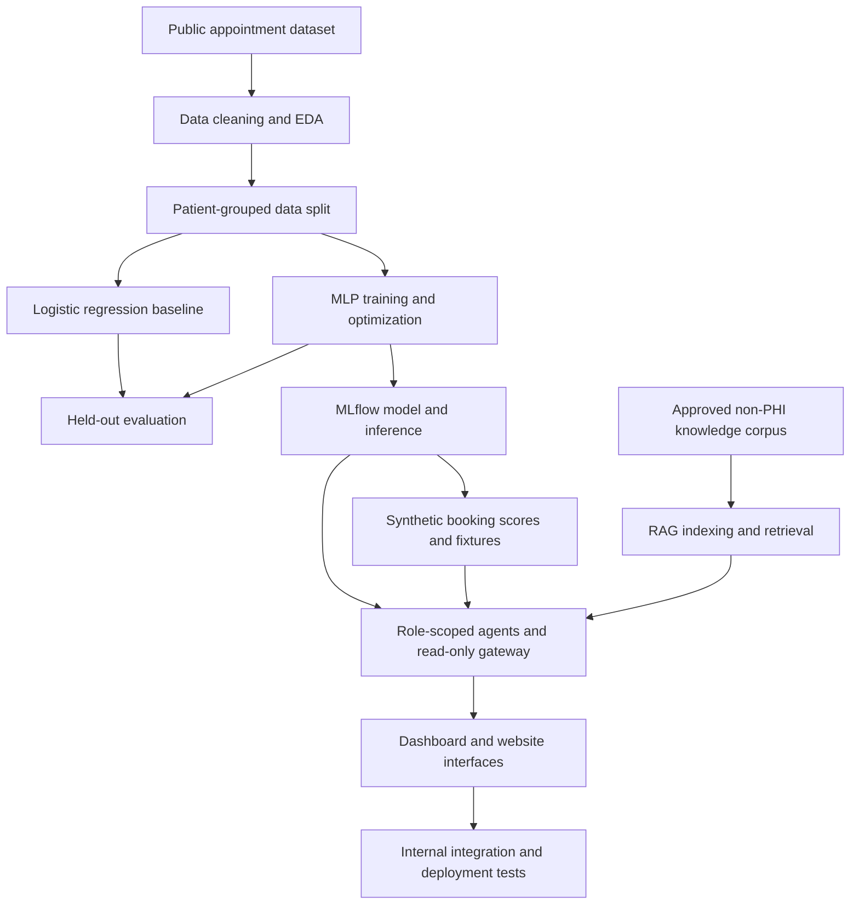

# Eye Style Optometry: AI Operations & Workflow Intelligence

**University of San Diego | Master of Science in Applied Artificial Intelligence | AAI590 Capstone | Team 2**

## Project Overview

Independent optometry practices manage scheduling, insurance verification, optical orders and patient follow-up across multiple operational workflows. This capstone develops an educational AI-powered decision-support prototype for Eye Style Optometry to help staff identify unresolved tasks, prioritize follow-up and retrieve relevant operational information.

The platform combines supervised machine learning, retrieval-augmented generation (RAG), role-scoped AI agents and dashboard-facing interfaces. It is designed to support staff decisions rather than autonomously change patient records or make clinical decisions.

**Project status:** Prototype evaluation completed in the original notebook; the original notebook has been organized into modular GitHub stages. The separated pipeline requires end-to-end Databricks validation. Live Crystal PM integration, production authentication and HTTP deployment remain future work.

## Team Members

| Team member | GitHub | Responsibilities |
|---|---|---|
| Thomas Geraci | [@Tom123454321876](https://github.com/Tom123454321876) | AI architecture, agent orchestration, security, dashboard integration and system evaluation |
| Denis Mulabegovic | [@DMulabegovic](https://github.com/DMulabegovic) | Logistic regression, neural network development, hyperparameter optimization, evaluation and inference |
| Daniel Sims | [@dsims21](https://github.com/dsims21) | Data preparation, exploratory data analysis, synthetic records, RAG retrieval and grounding evaluation |

## Core Capabilities

- **Scheduling:** Booking-time no-show scoring and staff follow-up prioritization.
- **Insurance verification:** Identification of missing or unresolved verification information.
- **Optical orders:** Read-only order status, delays and follow-up reporting.
- **Knowledge assistant:** Retrieval of relevant operational guidance, source-grounded answers and abstention when evidence is insufficient.
- **Role-scoped agents:** Restricted tool access, routing and human approval requirements.
- **Dashboard integration:** Structured outputs and internal website-facing interfaces for operational review.

## System Architecture

See [architecture documentation](docs/architecture.md) for additional implementation details.

## Technology Stack

| Technology | Purpose |
|---|---|
| Python and Jupyter | Development, experimentation and reproducible notebook stages |
| Databricks | Shared development environment, compute and data storage |
| Pandas and NumPy | Data cleaning, transformation and analysis |
| Scikit-learn | Preprocessing, logistic regression and evaluation metrics |
| TensorFlow / Keras | Multilayer perceptron training and optimization |
| MLflow | Model logging, loading and verification |
| Sentence Transformers | Dense retrieval embeddings |
| Databricks model serving / OpenAI-compatible SDK | Language-model inference |
| Matplotlib and Seaborn | Exploratory and evaluation visualizations |
| GitHub | Version control, collaboration and documentation |

## Data and Machine Learning

The predictive component uses the public [Medical Appointment No Shows dataset](https://www.kaggle.com/datasets/joniarroba/noshowappointments). Six invalid records were excluded, leaving 110,521 appointments. The dataset is not from Eye Style Optometry and does not establish performance in a U.S. optometry practice.

| Partition | Appointments |
|---|---:|
| Training | 77,565 |
| Validation | 16,534 |
| Held-out test | 16,422 |

Patient-grouped splitting prevents patient overlap between partitions. Preprocessing is fitted on training records only. Booking-time features exclude patient identifiers and SMS status to reduce leakage risks. The operational prototype uses synthetic Crystal-style records and a separate non-PHI knowledge corpus.

The predictive pipeline compares a class-weighted logistic regression baseline with a regularized multilayer perceptron (MLP). Optimization includes hidden-layer widths, dropout, early stopping and validation-based threshold selection. The test set is reserved for final evaluation. The resulting no-show score is uncalibrated and intended for human-reviewed follow-up only.

### Model Architecture and Optimization

The selected MLP accepts 95 preprocessed input dimensions, with two hidden layers of 64 and 32 ReLU units, 20% dropout after each hidden layer and a sigmoid output. Training uses binary cross-entropy, Adam (learning rate 0.001), batch size 64, a maximum of 100 epochs, class weighting and early stopping (patience 10). Four architecture/dropout configurations were compared using validation F1; the selected cutoff was 0.50. The held-out test partition was reserved for evaluation.

## Evaluation Results

The following are historical results from the original Week 6 notebook, not newly reproduced results from the modular repository.

| Evaluation | Reported result |
|---|---:|
| MLP no-show recall | 77.05% |
| MLP no-show F1 | 43.68% |
| MLP ROC-AUC | 72.02% |
| RAG in-corpus grounded answers | 15/15 (100%) |
| RAG appropriate abstention | 5/5 (100%) |
| Broad workflow task completion | 9/9 (100%) |
| Strict workflow correctness | 7/9 (77.8%) |
| Median AI workflow execution time | 6.418 seconds |
| Website interface checks | 14/14 passed |
| Internal deployment checks | 6/6 passed |

The selected RAG experiment used 95-word chunks, 25-word overlap and top-k = 3. Grounding was evaluated on a fixed question set using LLM judging; additional independent evaluation is necessary. No paired manual workflow timing baseline was collected, so a speed improvement over staff workflows has not been established. Model precision, subgroup disparities and false positives remain important deployment concerns.

### Held-Out Model Comparison (16,422 Appointments)

| Metric | Logistic regression | MLP |
|---|---:|---:|
| Accuracy | 0.6622 | 0.6003 |
| Precision | 0.3103 | 0.3048 |
| Recall | 0.5559 | 0.7705 |
| F1 | 0.3983 | 0.4368 |
| ROC-AUC | 0.6620 | 0.7202 |
| PR-AUC | 0.3015 | 0.3487 |

The MLP improved recall and ranking metrics but reduced accuracy and precision. Strict workflow correctness (77.8%) fell below the 90% target because two answers described uncalibrated scores as probabilities. The three workflows were demonstrated internally, but browser-based end-to-end execution remains unverified. The designed policy, runtime and adversarial suites passed 10/10, 12/12 and 4/4 cases respectively; these limited tests are not proof of production security.

See [evaluation results](docs/results.md) for limitations and model-run provenance.

## Repository Structure and File Inventory

The following inventory describes every tracked file in the reviewed repository snapshot. The 25 stage notebooks and one driver notebook share a Databricks Python namespace. See [execution order](docs/execution_order.md) for the actual dependency order; folder numbering alone is not the execution order.

### Root and Configuration

| File | Description |
|---|---|
| [`.github/CODEOWNERS`](.github/CODEOWNERS) | Defines review ownership for repository workstreams. |
| [`.gitignore`](.gitignore) | Excludes local artifacts and sensitive files from version control; review before committing. |
| [`README.md`](README.md) | Project overview, file inventory, execution instructions, results and limitations. |
| [`requirements.txt`](requirements.txt) | Python dependency ranges for the notebook pipeline. |
| [`run_pipeline.ipynb`](run_pipeline.ipynb) | Databricks driver for sequential execution in one shared namespace. |
| [`run_stages.py`](run_stages.py) | Reads the stage manifest and executes notebook code cells in a shared namespace. |
| [`config/__init__.py`](config/__init__.py) | Marks the configuration package. |
| [`config/project_config.py`](config/project_config.py) | Shared dataset metadata and original Unity Catalog volume paths. |
| [`config/stages.json`](config/stages.json) | Ordered manifest of 25 notebook stages and their ownership. |

### Data Preparation

| File | Description |
|---|---|
| [`data_pipeline/01_data_cleaning.ipynb`](data_pipeline/01_data_cleaning.ipynb) | Validates appointments, removes invalid records, derives features and saves cleaned data. |
| [`data_pipeline/02_exploratory_data_analysis.ipynb`](data_pipeline/02_exploratory_data_analysis.ipynb) | Explores outcome imbalance, age, lead time and feature relationships; generates EDA plots. |
| [`data_pipeline/03_synthetic_crystal_data.ipynb`](data_pipeline/03_synthetic_crystal_data.ipynb) | Generates synthetic clinic records and booking scores for prototype testing. |

### Machine Learning

| File | Description |
|---|---|
| [`machine_learning/01_logistic_regression.ipynb`](machine_learning/01_logistic_regression.ipynb) | Creates patient-disjoint partitions, fits preprocessing and trains the class-weighted baseline. |
| [`machine_learning/02_mlp_training.ipynb`](machine_learning/02_mlp_training.ipynb) | Trains the regularized neural classifier and produces learning curves and validation metrics. |
| [`machine_learning/03_model_optimization.ipynb`](machine_learning/03_model_optimization.ipynb) | Compares hidden-layer widths, dropout and validation decision thresholds. |
| [`machine_learning/04_model_export_and_verification.ipynb`](machine_learning/04_model_export_and_verification.ipynb) | Exports the chosen model, logs it to MLflow and checks reload parity. |
| [`machine_learning/05_model_evaluation.ipynb`](machine_learning/05_model_evaluation.ipynb) | Compares held-out metrics, confusion matrices and subgroup errors. |
| [`machine_learning/06_model_inference.ipynb`](machine_learning/06_model_inference.ipynb) | Loads the verified model run and implements booking-time scoring. |

### Retrieval-Augmented Generation

| File | Description |
|---|---|
| [`rag/01_knowledge_corpus.ipynb`](rag/01_knowledge_corpus.ipynb) | Builds and persists the non-PHI knowledge corpus and source manifest. |
| [`rag/02_chunking_and_vector_index.ipynb`](rag/02_chunking_and_vector_index.ipynb) | Chunks documents, embeds passages, builds the index and implements grounded retrieval. |
| [`rag/03_retrieval_optimization.ipynb`](rag/03_retrieval_optimization.ipynb) | Compares chunk sizes, overlap and top-k using fixed evaluation questions. |
| [`rag/04_grounding_evaluation.ipynb`](rag/04_grounding_evaluation.ipynb) | Evaluates retrieved evidence, answer grounding and appropriate abstention. |

### Agents

| File | Description |
|---|---|
| [`agents/01_agent_framework.ipynb`](agents/01_agent_framework.ipynb) | Initializes agent tools, routing, workspace configuration and deterministic demo checks. |
| [`agents/02_model_integration.ipynb`](agents/02_model_integration.ipynb) | Connects booking-time model scoring to the agent framework. |
| [`agents/03_specialist_agents.ipynb`](agents/03_specialist_agents.ipynb) | Defines specialist workflow responsibilities and routing. |
| [`agents/04_agent_security.ipynb`](agents/04_agent_security.ipynb) | Exercises role boundaries, runtime safeguards and adversarial requests. |
| [`agents/05_policy_matrix.ipynb`](agents/05_policy_matrix.ipynb) | Defines and checks specialist permissions and allowed actions. |

### Integration

| File | Description |
|---|---|
| [`integration/01_dashboard_output_contract.ipynb`](integration/01_dashboard_output_contract.ipynb) | Builds structured dashboard outputs and validates their contract. |
| [`integration/02_website_backend.ipynb`](integration/02_website_backend.ipynb) | Defines internal website-facing backend interfaces. |
| [`integration/03_operational_data_gateway.ipynb`](integration/03_operational_data_gateway.ipynb) | Implements and tests read-only operational access to synthetic records. |
| [`integration/04_deployment_interface.ipynb`](integration/04_deployment_interface.ipynb) | Defines deployment-facing chat, dashboard and capability interfaces. |

### Evaluation

| File | Description |
|---|---|
| [`evaluation/01_workflow_evaluation.ipynb`](evaluation/01_workflow_evaluation.ipynb) | Evaluates scripted staff workflows, correctness and AI execution timing. |
| [`evaluation/02_website_integration_tests.ipynb`](evaluation/02_website_integration_tests.ipynb) | Checks internal website-facing interfaces, including RAG and permissions. |
| [`evaluation/03_deployment_readiness.ipynb`](evaluation/03_deployment_readiness.ipynb) | Checks internal deployment-facing functions; not a live HTTP test. |

### Proposed HTTP Backend

| File | Description |
|---|---|
| [`backend/README.md`](backend/README.md) | Documents the proposed HTTP bridge, private configuration and upstream serving contract. |
| [`backend/main.py`](backend/main.py) | Proposed FastAPI adapter for Firebase identity and upstream Databricks requests; not end-to-end validated. |
| [`backend/Dockerfile`](backend/Dockerfile) | Container build definition for the proposed HTTP adapter. |
| [`backend/requirements.txt`](backend/requirements.txt) | Separate Python dependencies for the HTTP adapter. |

### Reusable Source, Tests and Tools

| File | Description |
|---|---|
| [`src/__init__.py`](src/__init__.py) | Marks the reusable source package. |
| [`src/agents/__init__.py`](src/agents/__init__.py) | Marks the agent utility package. |
| [`src/agents/framework.py`](src/agents/framework.py) | Reusable agent framework and supporting logic. |
| [`src/data/__init__.py`](src/data/__init__.py) | Marks the data utility package. |
| [`src/data/synthetic_loader.py`](src/data/synthetic_loader.py) | Utility for loading synthetic operational data. |
| [`tests/test_repository_structure.py`](tests/test_repository_structure.py) | Tests repository structure and exclusion of private specification artifacts. |
| [`tools/extract_private_spec.py`](tools/extract_private_spec.py) | Authorized local-only utility for extracting a private vendor contract; output must not be committed. |

### Documentation

| File | Description |
|---|---|
| [`docs/architecture.md`](docs/architecture.md) | Additional system architecture description. |
| [`docs/data_dictionary.md`](docs/data_dictionary.md) | Dataset and operational field descriptions. |
| [`docs/execution_order.md`](docs/execution_order.md) | Stage order, original cell mapping, dependencies and mandatory review gates. |
| [`docs/github_upload.md`](docs/github_upload.md) | GitHub contribution and upload guidance. |
| [`docs/migration_notes.md`](docs/migration_notes.md) | Notes on splitting the original notebook into modular stages. |
| [`docs/private_setup.md`](docs/private_setup.md) | Authorized private storage, dataset and workspace setup instructions. |
| [`docs/results.md`](docs/results.md) | Historical Week 6 metrics, provenance and limitations. |

## Installation and Execution

1. Clone this repository into an authorized Databricks Git folder.
2. Install dependencies from `requirements.txt` in a compatible Databricks environment.
3. Obtain the public appointment dataset and configure authorized private storage and workspace access following [private setup](docs/private_setup.md).
4. Open `run_pipeline.ipynb` and execute the stages in the order specified in [execution order](docs/execution_order.md).
5. Review newly generated answers at the required manual review gates and compare new metrics with [historical results](docs/results.md).

The 25 functional notebooks are linked stages that share a Python namespace; they are not all independently executable. Dependency ranges are not a verified lockfile. The modular code has undergone static checks but requires runtime validation in Databricks before reproducibility can be claimed.

### Setup and Verification Details

- Use the authorized Databricks workspace and compatible runtime. The original volume is documented in [private setup](docs/private_setup.md); place the Kaggle CSV in its `raw` directory and back up existing artifacts before executing stages that overwrite them.
- Install dependencies with `%pip install -r requirements.txt` in a Databricks notebook when the repository root is the working directory, or provide the absolute path to the dependency file. Ensure TensorFlow, MLflow, embedding-model downloads and authorized model-serving access are available.
- Execute stages 1–25 through the driver, preserving the shared namespace. Resolve errors before proceeding. Follow the manual fresh-answer review gates in [execution order](docs/execution_order.md); do not reuse historical judgments for new generations.
- From the repository root, the structural tests can be run using `python -m unittest discover -s tests`. These checks do not execute the ML or agent pipeline.
- The public modular notebooks omit saved outputs. Historical metrics refer to the executed original notebook and final report, not a fresh modular run.

### Proposed Backend Adapter

The `backend/` directory contains a proposed containerized FastAPI HTTP bridge for Firebase-authenticated requests to a custom Databricks serving endpoint.

The routes are:

- `GET /health`
- `POST /chat`
- `GET /dashboard`
- `GET /capabilities`

The health route is a process check, not an end-to-end readiness test. The other routes require Firebase ID tokens; private Cloud Run IAM tests also require an invoker identity token. Configure credentials privately and exact permitted origins.

See [backend instructions](backend/README.md) for prerequisites and the proposed upstream schema.

The custom upstream serving package is not included and the bridge has not been validated end-to-end. No production frontend source is included in this repository snapshot; the integration notebooks document internal website-facing interfaces.

## Security, Privacy and Responsible AI

- Public appointment data and synthetic operational records are used for prototype evaluation; production patient data is not required.
- Role-scoped policies and read-only gateway checks restrict permitted operations. These are prototype controls, not proof of production authorization security.
- Appointment scores must never automatically cancel, overbook or modify appointments.
- Credentials, private datasets, vendor API specifications, saved predictions and model binaries must not be committed to the public repository.
- Any vendor contract required for development must be supplied privately with authorization. If authorization is unavailable, use an approved synthetic-only substitute and validate the gateway.
- Production identity verification, least-privilege authorization and human approval must be enforced at the deployed service boundary.

## Limitations and Future Work

The current prototype does not establish clinical performance, live Crystal PM connectivity or real-world workflow efficiency. Future work includes representative clinic-data validation, probability calibration, subgroup fairness analysis, additional retrieval evaluation, paired staff timing studies, production authentication, secure API deployment and monitoring. The modular pipeline also requires end-to-end reproduction testing.

## Collaboration and Documentation

Team members maintain their respective workstreams through feature branches, descriptive commits and reviewed pull requests into `main`.

Additional project documentation:

- [System Architecture](docs/architecture.md)
- [Data Dictionary](docs/data_dictionary.md)
- [Execution Order](docs/execution_order.md)
- [Evaluation Results](docs/results.md)
- [GitHub Contribution Instructions](docs/github_upload.md)
- [Migration Notes](docs/migration_notes.md)
- [Private Environment Setup](docs/private_setup.md)

## References

- Hoppen, J. (2016). *Medical Appointment No Shows* [Data set]. Kaggle. https://www.kaggle.com/datasets/joniarroba/noshowappointments
- Carreras-García, D., et al. (2020). Patient no-show prediction: A systematic literature review. *Entropy, 22*(6), 675. https://doi.org/10.3390/e22060675
- Lewis, P., et al. (2020). Retrieval-augmented generation for knowledge-intensive NLP tasks. *Advances in Neural Information Processing Systems, 33*, 9459–9474.
- Mohammadi, I., et al. (2018). Data analytics and modeling for appointment no-show in community health centers. *Journal of Primary Care & Community Health, 9*. https://doi.org/10.1177/2150132718811692
- Salazar, L. H. A., et al. (2022). No-show in medical appointments with machine learning techniques: A systematic literature review. *Information, 13*(11), 507. https://doi.org/10.3390/info13110507
- Zakka, C., et al. (2024). Almanac — Retrieval-augmented language models for clinical medicine. *NEJM AI, 1*(2). https://doi.org/10.1056/AIoa2300068

---

**University of San Diego — AAI590 Capstone, Team 2**

Educational research prototype; not a production clinical system.
