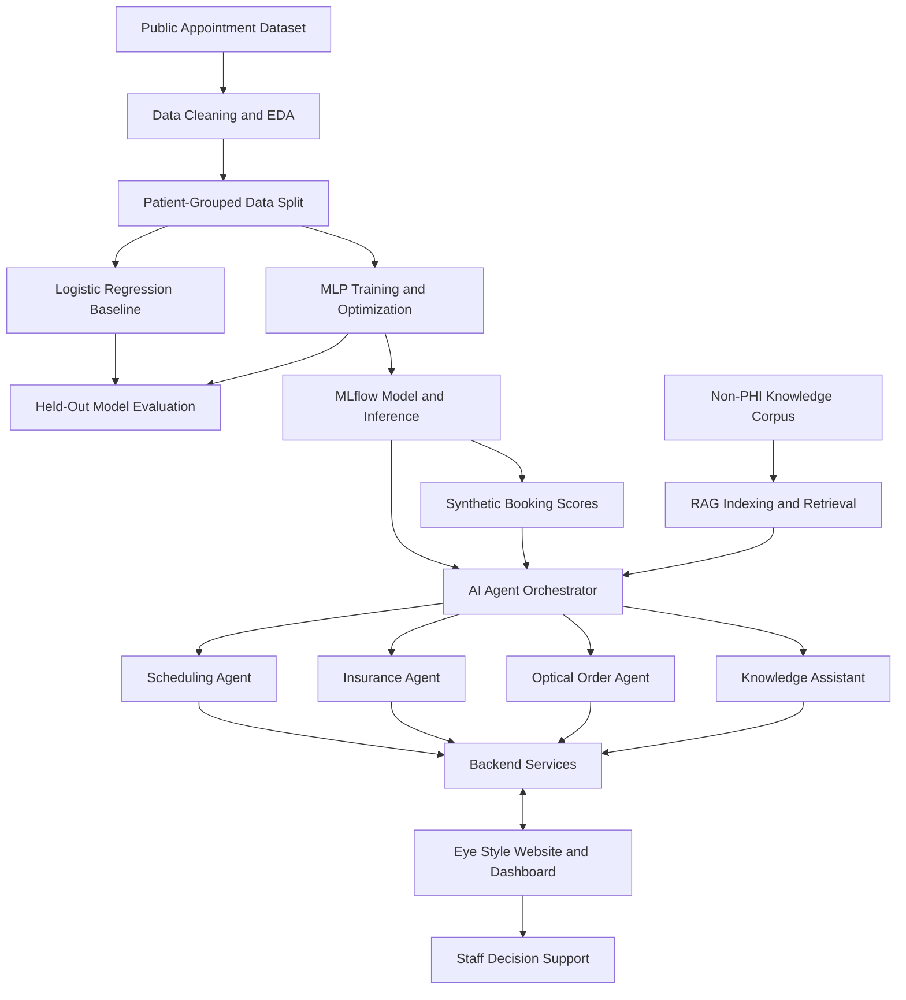

# Eye Style Optometry: AI Operations & Workflow Intelligence

**University of San Diego | Master of Science in Applied Artificial Intelligence | AAI590 Capstone | Team 2**


## Project Overview

Independent optometry practices manage scheduling, insurance verification, optical orders, and patient follow-up across multiple operational workflows. This capstone develops an AI-powered operations and workflow intelligence platform for Eye Style Optometry to help staff identify unresolved tasks, prioritize follow-up, and retrieve relevant operational information.

The platform combines supervised machine learning, retrieval-augmented generation (RAG), role-scoped AI agents, backend services, and an integrated web-based dashboard. It is designed to support staff decisions rather than autonomously change patient records or make clinical decisions.

The AI system has been connected to the website and is operational as a working prototype, according to the development team's integration update.

The project demonstrates how predictive analytics, intelligent agents, and grounded knowledge retrieval can be combined into a unified healthcare operations platform.

## Project Status

| Component | Status |
|---|---|
| Data cleaning and preprocessing | Completed |
| Exploratory data analysis | Completed |
| Logistic regression baseline | Trained and evaluated |
| Deep-learning MLP | Trained and evaluated |
| Model optimization | Completed |
| MLflow model persistence | Completed |
| RAG knowledge pipeline | Implemented and evaluated |
| Specialist AI agents | Implemented and evaluated |
| Agent security testing | Completed on designed test cases |
| Dashboard-facing interfaces | Implemented |
| Website and AI connectivity | Connected and running |
| GitHub modular organization | Completed |
| Independent modular pipeline reproduction | Pending |
| Live Crystal PM integration | Future work |
| Production security validation | Future work |

The original executed Databricks notebook contains the completed training, optimization, and evaluation results. The notebook has also been organized into modular stages within this repository.

Website connectivity has been established. Comprehensive browser-based workflow, authentication, and production security testing should be documented separately as those evaluations are completed.

## Team Members

| Team Member | GitHub | Responsibilities |
|---|---|---|
| Thomas Geraci | [@Tom123454321876](https://github.com/Tom123454321876) | AI architecture, agent orchestration, backend services, security, website integration, and system evaluation |
| Denis Mulabegovic | [@DMulabegovic](https://github.com/DMulabegovic) | Logistic regression, neural network development, hyperparameter optimization, model evaluation, and inference |
| Daniel Sims | [@dsims21](https://github.com/dsims21) | Data preparation, exploratory data analysis, synthetic records, RAG retrieval, and grounding evaluation |

## Project Objectives

The primary objective is to develop an integrated AI decision-support platform that improves the accessibility and organization of optometry practice information.

The project focuses on three core operational workflows:

- Appointment scheduling and no-show risk prioritization.
- Insurance verification and appointment readiness.
- Optical order tracking and follow-up.

Additional objectives include:

- Training and evaluating a deep-learning model.
- Comparing neural network performance against a traditional machine-learning baseline.
- Developing a retrieval-augmented knowledge assistant.
- Implementing specialist AI agents with scoped permissions.
- Integrating AI capabilities with a web-based dashboard.
- Evaluating model performance, response accuracy, and operational safeguards.

## Core Capabilities

### Scheduling Agent

- Booking-time appointment risk scoring.
- Identification of appointments requiring staff follow-up.
- Appointment information retrieval.
- Human-reviewed scheduling recommendations.

### Insurance Verification Agent

- Identification of unresolved insurance verification tasks.
- Appointment-readiness reporting.
- Retrieval of insurance-related operational information.
- Staff decision support.

### Optical Order Agent

- Optical order status retrieval.
- Delayed order identification.
- Order follow-up recommendations.
- Structured operational reporting.

### RAG Knowledge Assistant

- Retrieval of relevant operational guidance.
- Source-grounded answers.
- Knowledge retrieval from a non-PHI document corpus.
- Abstention when supporting evidence is insufficient.

### Website and Dashboard

- Connected AI assistant.
- Role-oriented operational workflows.
- Structured dashboard information.
- Backend communication with AI services.
- Staff-facing decision support.

### Security and Human Oversight

- Scoped agent permissions.
- Read-only operational data access.
- Unauthorized-action safeguards.
- Human approval requirements for consequential actions.

## System Architecture



See [Architecture Documentation](docs/architecture.md) for additional implementation details.

## Technology Stack

| Technology | Purpose |
|---|---|
| Python | Machine learning, data processing, agents, and backend development |
| Jupyter Notebooks | Model experimentation and documented execution |
| Databricks | AI development, compute, model training, and data storage |
| Pandas | Data cleaning and transformation |
| NumPy | Numerical computation |
| Scikit-learn | Preprocessing, logistic regression, and evaluation metrics |
| TensorFlow | Deep-learning model development |
| Keras | Neural network architecture and training |
| MLflow | Model tracking, persistence, and verification |
| Sentence Transformers | Dense document embeddings |
| Databricks Model Serving / OpenAI-Compatible SDK | Language-model inference |
| FastAPI | HTTP backend adapter development |
| Firebase | Application authentication and integration architecture |
| Matplotlib | Data and model visualizations |
| Seaborn | Exploratory data analysis |
| GitHub | Version control, collaboration, and documentation |

## Dataset

The predictive component uses the publicly available [Medical Appointment No Shows Dataset](https://www.kaggle.com/datasets/joniarroba/noshowappointments).

### Dataset Summary

| Attribute | Value |
|---|---:|
| Original appointment records | 110,527 |
| Invalid records removed | 6 |
| Cleaned appointment records | 110,521 |
| Attended appointments | 88,207 |
| Missed appointments | 22,314 |
| No-show rate | 20.19% |

The dataset contains patient demographics, scheduling information, selected health indicators, and appointment attendance outcomes.

The original dataset was not collected at Eye Style Optometry. Therefore, the predictive results represent prototype performance and should not be interpreted as validated clinical or operational performance for the practice.

### Data Preparation

Data preparation includes:

- Missing-value inspection.
- Duplicate-record detection.
- Appointment identifier validation.
- Invalid age detection.
- Appointment date validation.
- Booking lead-time calculation.
- Appointment weekday extraction.
- Target variable encoding.
- Numerical feature standardization.
- Categorical feature encoding.
- Patient-grouped dataset splitting.

Patient identifiers and appointment identifiers are excluded from model predictors.

SMS reminder status is excluded from booking-time prediction to reduce potential information leakage.

### Dataset Partitions

| Partition | Appointments |
|---|---:|
| Training | 77,565 |
| Validation | 16,534 |
| Held-out testing | 16,422 |
| Total | 110,521 |

Patient-grouped splitting prevents the same patient from appearing across multiple partitions.

Preprocessing transformations are fitted exclusively on training data.

### Synthetic Operational Data

The operational system uses synthetic Crystal-style records rather than production patient records.

| Synthetic Data Category | Records |
|---|---:|
| Patients | 30 |
| Appointments | 40 |
| Insurance verifications | 30 |
| Frame orders | 25 |
| Contact lens orders | 15 |

The synthetic data supports AI agent development, dashboard integration, operational reporting, and controlled system testing.

## Machine Learning Models

### Logistic Regression

Logistic regression serves as the traditional machine-learning baseline.

The implementation uses class weighting to address the imbalance between attended and missed appointments.

The baseline establishes a reference point for comparing neural network performance.

### Multilayer Perceptron

The deep-learning component uses a TensorFlow/Keras multilayer perceptron to estimate appointment no-show risk.

### Final Model Architecture

| Layer | Configuration |
|---|---|
| Input | 95 preprocessed features |
| Hidden layer 1 | 64 neurons |
| Activation | ReLU |
| Dropout | 0.20 |
| Hidden layer 2 | 32 neurons |
| Activation | ReLU |
| Dropout | 0.20 |
| Output layer | 1 neuron |
| Output activation | Sigmoid |

### Training Configuration

| Hyperparameter | Value |
|---|---|
| Optimizer | Adam |
| Learning rate | 0.001 |
| Loss function | Binary cross-entropy |
| Batch size | 64 |
| Maximum epochs | 100 |
| Early stopping patience | 10 |
| Class weighting | Balanced |
| Random seed | 42 |
| Selected decision threshold | 0.50 |

The model produces an uncalibrated risk score intended to support staff follow-up prioritization.

The score should not be interpreted as an independently calibrated probability of patient nonattendance.

## Model Optimization

Four neural network architecture and dropout configurations were evaluated.

| Hidden Layers | Dropout | Selected Threshold | Validation F1 |
|---|---:|---:|---:|
| 64–32 | 0.20 | 0.50 | 0.4541 |
| 64–32 | 0.30 | 0.50 | 0.4504 |
| 32–16 | 0.20 | 0.50 | 0.4498 |
| 128–64 | 0.20 | 0.45 | 0.4493 |

The selected architecture achieved the highest observed validation F1 score.

Additional optimization included classification threshold evaluation, early stopping, dropout regularization, and class weighting.

Final model selection was performed using validation data rather than the held-out test set.

## Machine Learning Results

The following results originate from the completed Week 6 notebook execution and are documented in the final project report.

### Held-Out Test Performance

| Metric | Logistic Regression | MLP |
|---|---:|---:|
| Accuracy | 0.6622 | 0.6003 |
| Precision | 0.3103 | 0.3048 |
| Recall | 0.5559 | 0.7705 |
| F1 Score | 0.3983 | 0.4368 |
| ROC-AUC | 0.6620 | 0.7202 |
| PR-AUC | 0.3015 | 0.3487 |

The MLP improved recall, F1, ROC-AUC, and PR-AUC relative to logistic regression.

Recall improved from 55.59% to 77.05%, representing an increase of 21.46 percentage points.

The neural model identified additional missed appointments but produced more false positives. These results support its use as a staff-reviewed prioritization tool rather than an autonomous scheduling system.

### Confusion Matrix Results

| Outcome | Logistic Regression | MLP |
|---|---:|---:|
| True negatives | 9,039 | 7,313 |
| False positives | 4,080 | 5,806 |
| False negatives | 1,467 | 758 |
| True positives | 1,836 | 2,545 |

Model persistence and MLflow reload verification were also completed.

The maximum observed difference between original and reloaded validation predictions was 0.0.

## Retrieval-Augmented Generation

The RAG pipeline supports operational knowledge retrieval using a non-PHI document collection.

The pipeline includes:

1. Knowledge document preparation.
2. Source metadata assignment.
3. Document chunking.
4. Text embedding.
5. Vector indexing.
6. Relevant passage retrieval.
7. Grounded answer generation.
8. Evidence evaluation and abstention.

### Selected Retrieval Configuration

| Parameter | Configuration |
|---|---|
| Embedding model | all-MiniLM-L6-v2 |
| Chunk size | 95 words |
| Chunk overlap | 25 words |
| Retrieved passages | 3 |
| Indexed chunks | 20 |

### RAG Evaluation Results

| Evaluation Metric | Result |
|---|---:|
| Expected-document retrieval | 15/15 |
| Grounded answers | 15/15 |
| Correct abstention | 5/5 |
| Overall evaluation | 20/20 |
| Document hit rate | 100% |
| Mean reciprocal rank | 1.00 |
| Median response time | 1.243 seconds |

The grounding evaluation was performed using a fixed question set and an LLM-based judge.

Additional independent human evaluation and unseen questions are necessary to establish broader generalization.

## AI Agent and System Evaluation

The AI architecture uses specialist agents with scoped operational responsibilities.

An orchestrator routes requests to appropriate workflow agents while restricting access to unauthorized actions.

### Evaluation Results

| Evaluation | Result |
|---|---:|
| Broad workflow task completion | 9/9 |
| Strict workflow correctness | 7/9 |
| Policy matrix tests | 10/10 |
| Runtime safety tests | 12/12 |
| Adversarial tests | 4/4 |
| Website interface checks | 14/14 |
| Operational gateway checks | 10/10 |
| Deployment interface checks | 6/6 |
| Median AI workflow execution time | 6.418 seconds |

Strict workflow correctness was 77.8%, below the predefined 90% target. Two responses incorrectly characterized uncalibrated scores as probabilities.

Updated deployment-facing outputs include explicit uncalibrated-score notices. A repeated strict-correctness evaluation is required before claiming an improved measured score.

These test suites evaluate different system components and should not be combined into a single production security metric.

## Website and AI Integration

The AI has been connected to the Eye Style website and is operational as a working prototype.

The integrated architecture provides a staff-facing interface for interacting with the AI system and accessing operational decision-support capabilities.

The system combines:

- Website and dashboard interfaces.
- Backend communication services.
- Databricks-based AI processing.
- Predictive model inference.
- Specialist agent orchestration.
- RAG knowledge retrieval.
- Structured operational outputs.

The original notebook completed internal website-facing interface tests, operational gateway tests, and deployment-facing function tests.

The development team subsequently established website-to-AI connectivity.

The successful connection represents an important implementation milestone beyond the original notebook-based prototype.

However, website connectivity does not independently establish complete browser-based workflow correctness, production authentication security, real patient-data integration, or clinical effectiveness.

### Backend Interface

The repository includes an HTTP backend adapter architecture with the following routes:

| Method | Endpoint | Purpose |
|---|---|---|
| GET | `/health` | Backend process health |
| POST | `/chat` | AI assistant requests |
| GET | `/dashboard` | Structured dashboard information |
| GET | `/capabilities` | Supported system capabilities |

See [Backend Documentation](backend/README.md) for the adapter configuration and implementation requirements.

The repository's backend adapter and the currently running website deployment must be checked for version consistency before claiming exact reproducibility of the deployed system.

## Repository Structure

```text
USD-AAI590-Capstone/
│
├── .github/
├── agents/
├── backend/
├── config/
├── data_pipeline/
├── docs/
├── evaluation/
├── integration/
├── machine_learning/
├── rag/
├── src/
├── tests/
├── tools/
│
├── .gitignore
├── README.md
├── requirements.txt
├── run_pipeline.ipynb
└── run_stages.py
```

## Complete Repository File Inventory

The following inventory documents each file in the reviewed repository snapshot.

### Root and Configuration

| File | Description |
|---|---|
| [`.github/CODEOWNERS`](.github/CODEOWNERS) | Defines code review ownership and team responsibilities. |
| [`.gitignore`](.gitignore) | Excludes sensitive files and unnecessary generated artifacts. |
| [`README.md`](README.md) | Main project documentation, results, installation, and file inventory. |
| [`requirements.txt`](requirements.txt) | Python dependency requirements. |
| [`run_pipeline.ipynb`](run_pipeline.ipynb) | Main notebook driver for sequential pipeline execution. |
| [`run_stages.py`](run_stages.py) | Executes notebook stages using a shared Python namespace. |
| [`config/__init__.py`](config/__init__.py) | Initializes the configuration package. |
| [`config/project_config.py`](config/project_config.py) | Defines shared project configuration and storage metadata. |
| [`config/stages.json`](config/stages.json) | Defines the ordered pipeline stage manifest. |

### Data Pipeline

| File | Description |
|---|---|
| [`data_pipeline/01_data_cleaning.ipynb`](data_pipeline/01_data_cleaning.ipynb) | Cleans the appointment dataset, validates records, and derives predictive features. |
| [`data_pipeline/02_exploratory_data_analysis.ipynb`](data_pipeline/02_exploratory_data_analysis.ipynb) | Examines variable distributions, correlations, class imbalance, and appointment patterns. |
| [`data_pipeline/03_synthetic_crystal_data.ipynb`](data_pipeline/03_synthetic_crystal_data.ipynb) | Generates synthetic operational records and booking scores. |

### Machine Learning

| File | Description |
|---|---|
| [`machine_learning/01_logistic_regression.ipynb`](machine_learning/01_logistic_regression.ipynb) | Prepares dataset partitions and trains the logistic regression baseline. |
| [`machine_learning/02_mlp_training.ipynb`](machine_learning/02_mlp_training.ipynb) | Builds and trains the neural network and generates learning curves. |
| [`machine_learning/03_model_optimization.ipynb`](machine_learning/03_model_optimization.ipynb) | Evaluates neural architectures, dropout configurations, and decision thresholds. |
| [`machine_learning/04_model_export_and_verification.ipynb`](machine_learning/04_model_export_and_verification.ipynb) | Exports the selected model, logs it to MLflow, and verifies model reload consistency. |
| [`machine_learning/05_model_evaluation.ipynb`](machine_learning/05_model_evaluation.ipynb) | Evaluates held-out performance, confusion matrices, and subgroup errors. |
| [`machine_learning/06_model_inference.ipynb`](machine_learning/06_model_inference.ipynb) | Implements model loading and booking-time risk inference. |

### Retrieval-Augmented Generation

| File | Description |
|---|---|
| [`rag/01_knowledge_corpus.ipynb`](rag/01_knowledge_corpus.ipynb) | Creates and maintains the non-PHI knowledge corpus. |
| [`rag/02_chunking_and_vector_index.ipynb`](rag/02_chunking_and_vector_index.ipynb) | Performs document chunking, embedding, indexing, and grounded retrieval. |
| [`rag/03_retrieval_optimization.ipynb`](rag/03_retrieval_optimization.ipynb) | Evaluates retrieval configurations, chunk sizes, overlap, and top-k. |
| [`rag/04_grounding_evaluation.ipynb`](rag/04_grounding_evaluation.ipynb) | Evaluates answer grounding, retrieval accuracy, and appropriate abstention. |

### AI Agents

| File | Description |
|---|---|
| [`agents/01_agent_framework.ipynb`](agents/01_agent_framework.ipynb) | Initializes agent tools, orchestration, routing, and environment configuration. |
| [`agents/02_model_integration.ipynb`](agents/02_model_integration.ipynb) | Connects predictive model inference to the specialist agent framework. |
| [`agents/03_specialist_agents.ipynb`](agents/03_specialist_agents.ipynb) | Implements scheduling, insurance, optical order, and knowledge agent responsibilities. |
| [`agents/04_agent_security.ipynb`](agents/04_agent_security.ipynb) | Evaluates runtime safeguards, unauthorized requests, and adversarial prompts. |
| [`agents/05_policy_matrix.ipynb`](agents/05_policy_matrix.ipynb) | Defines and evaluates specialist agent permissions and allowed actions. |

### System Integration

| File | Description |
|---|---|
| [`integration/01_dashboard_output_contract.ipynb`](integration/01_dashboard_output_contract.ipynb) | Defines structured dashboard outputs and validates response formats. |
| [`integration/02_website_backend.ipynb`](integration/02_website_backend.ipynb) | Implements internal website-facing backend interfaces. |
| [`integration/03_operational_data_gateway.ipynb`](integration/03_operational_data_gateway.ipynb) | Implements read-only access to synthetic operational records. |
| [`integration/04_deployment_interface.ipynb`](integration/04_deployment_interface.ipynb) | Defines deployment-facing chat, dashboard, and capability functions. |

### Evaluation

| File | Description |
|---|---|
| [`evaluation/01_workflow_evaluation.ipynb`](evaluation/01_workflow_evaluation.ipynb) | Evaluates scripted staff workflows, response correctness, and execution timing. |
| [`evaluation/02_website_integration_tests.ipynb`](evaluation/02_website_integration_tests.ipynb) | Evaluates internal website-facing interfaces and associated permissions. |
| [`evaluation/03_deployment_readiness.ipynb`](evaluation/03_deployment_readiness.ipynb) | Evaluates internal deployment-facing functions and readiness requirements. |

### Backend Services

| File | Description |
|---|---|
| [`backend/README.md`](backend/README.md) | Documents backend architecture, configuration, and integration prerequisites. |
| [`backend/main.py`](backend/main.py) | HTTP adapter architecture for authenticated backend and Databricks communication. |
| [`backend/Dockerfile`](backend/Dockerfile) | Defines the backend container build configuration. |
| [`backend/requirements.txt`](backend/requirements.txt) | Defines backend-specific Python dependencies. |

### Reusable Source Code

| File | Description |
|---|---|
| [`src/__init__.py`](src/__init__.py) | Initializes the reusable source package. |
| [`src/agents/__init__.py`](src/agents/__init__.py) | Initializes the agent utility package. |
| [`src/agents/framework.py`](src/agents/framework.py) | Provides reusable agent framework components. |
| [`src/data/__init__.py`](src/data/__init__.py) | Initializes the data utility package. |
| [`src/data/synthetic_loader.py`](src/data/synthetic_loader.py) | Provides utilities for loading synthetic operational records. |

### Testing and Utilities

| File | Description |
|---|---|
| [`tests/test_repository_structure.py`](tests/test_repository_structure.py) | Validates repository structure and exclusion of private specification artifacts. |
| [`tools/extract_private_spec.py`](tools/extract_private_spec.py) | Authorized local-only utility for handling private vendor specifications. Generated private material must not be committed. |

### Project Documentation

| File | Description |
|---|---|
| [`docs/architecture.md`](docs/architecture.md) | Documents system architecture and component relationships. |
| [`docs/data_dictionary.md`](docs/data_dictionary.md) | Describes dataset attributes and operational data fields. |
| [`docs/execution_order.md`](docs/execution_order.md) | Defines pipeline execution order, dependencies, and review checkpoints. |
| [`docs/github_upload.md`](docs/github_upload.md) | Documents repository contribution and upload procedures. |
| [`docs/migration_notes.md`](docs/migration_notes.md) | Documents the migration of the original notebook into modular stages. |
| [`docs/private_setup.md`](docs/private_setup.md) | Describes authorized private environment and storage configuration. |
| [`docs/results.md`](docs/results.md) | Documents historical execution results and evaluation limitations. |

## Required Capstone Code Components

This repository includes the six required machine-learning project components defined by the AAI590 Capstone Project Guidelines.

| Required Component | Repository Location |
|---|---|
| Data Cleaning | `data_pipeline/01_data_cleaning.ipynb` |
| Exploratory Data Analysis | `data_pipeline/02_exploratory_data_analysis.ipynb` |
| Model/Pipeline Design and Building | `machine_learning/01_logistic_regression.ipynb`, `machine_learning/02_mlp_training.ipynb`, `agents/`, `rag/` |
| Model Training | `machine_learning/02_mlp_training.ipynb` |
| Model Optimization | `machine_learning/03_model_optimization.ipynb`, `rag/03_retrieval_optimization.ipynb` |
| Model/Pipeline Analysis and Discussion | `machine_learning/05_model_evaluation.ipynb`, `evaluation/`, `docs/results.md` |

The repository additionally contains AI agent development, RAG implementation, security evaluation, backend development, dashboard integration, and system testing components.

## Installation and Setup

### Prerequisites

- Python environment compatible with the project dependencies.
- Authorized Databricks workspace.
- Git and GitHub access.
- Public appointment dataset.
- Required Databricks storage permissions.
- Authorized language-model serving access.
- Backend and website configuration for integration testing.

### Clone the Repository

```bash
git clone https://github.com/Tom123454321876/USD-AAI590-Capstone.git
cd USD-AAI590-Capstone
```

### Install Dependencies

```bash
pip install -r requirements.txt
```

Within Databricks, dependencies may be installed using:

```python
%pip install -r requirements.txt
```

Use the appropriate absolute repository path when necessary.

### Configure the Environment

Follow the instructions in:

- [Private Environment Setup](docs/private_setup.md)
- [Backend Configuration](backend/README.md)
- [Execution Order](docs/execution_order.md)

Credentials, private API specifications, and restricted data must be configured separately and must not be committed to GitHub.

## Pipeline Execution

The original executed notebook was reorganized into 25 functional notebook stages and one pipeline driver.

The modular pipeline preserves the project components while improving maintainability, collaboration, and documentation.

### Execution Overview

| Stage Group | Function |
|---|---|
| 1–2 | Data cleaning and exploratory data analysis |
| 3–8 | Model training, optimization, evaluation, persistence, and inference |
| 9–13 | Synthetic operational data and RAG |
| 14–25 | AI agents, security, integration, and system evaluation |

The exact execution sequence is defined in:

[`config/stages.json`](config/stages.json)

The corresponding execution instructions are available in:

[`docs/execution_order.md`](docs/execution_order.md)

### Running the Pipeline

1. Clone the repository into an authorized Databricks Git folder.
2. Open `run_pipeline.ipynb`.
3. Configure the repository path and required storage locations.
4. Install dependencies.
5. Execute the notebook stages in the documented order.
6. Maintain the shared Python namespace across stages.
7. Complete the required manual evaluation checkpoints.
8. Review generated results against the historical evaluation documentation.

Back up existing model and data artifacts before executing stages that may overwrite them.

The modular stages have undergone static syntax and repository structure checks. An independent complete execution of the reorganized pipeline remains a reproducibility validation task.

The original executed notebook provides the historical training and evaluation evidence, and the AI has subsequently been connected to the website.

### Repository Tests

From the repository root, execute:

```bash
python -m unittest discover -s tests
```

These tests validate repository structure and private artifact exclusions. They do not independently execute the complete AI pipeline.

## Project Evaluation Against Objectives

| Objective | Outcome |
|---|---|
| Train a deep-learning model | Achieved |
| Compare against a traditional ML baseline | Achieved |
| Optimize model architecture and thresholds | Achieved |
| Develop a RAG knowledge assistant | Achieved |
| Achieve at least 90% grounding on the designed RAG evaluation | Achieved |
| Develop three core operational workflows | Achieved at prototype level |
| Pass designed role-boundary tests | Achieved |
| Connect AI to website | Achieved |
| Achieve at least 90% strict workflow correctness | Not yet achieved in recorded evaluation |
| Establish improved staff task efficiency | Requires paired manual timing evaluation |
| Validate production readiness | Future work |

The project successfully demonstrates the integration of machine learning, retrieval-augmented generation, specialist AI agents, and a connected website prototype.

The results support the technical feasibility of the architecture while identifying additional validation requirements before production use.

## Security, Privacy, and Responsible AI

Healthcare-related AI systems require appropriate safeguards, data governance, and human oversight.

The project incorporates:

- Synthetic operational data.
- A non-PHI knowledge corpus.
- Role-scoped agent permissions.
- Read-only operational data access.
- Unauthorized-action safeguards.
- Human approval requirements.
- Grounded knowledge retrieval.
- Insufficient-evidence abstention.

The system is intended to support authorized staff and must not independently make clinical decisions or consequential changes to patient records.

No private patient information, API credentials, access tokens, or confidential vendor specifications should be included in the public repository.

The successful website connection does not constitute certification of HIPAA compliance or production security.

Production deployment requires additional identity verification, server-side authorization, audit logging, monitoring, data governance, and security validation.

## Limitations

The current implementation has the following limitations:

- The predictive dataset was not collected at Eye Style Optometry.
- Appointment risk scores have not been independently calibrated.
- Model precision and subgroup performance require additional evaluation.
- RAG evaluation used a limited fixed question set.
- Strict workflow correctness remains below the predefined target in the recorded evaluation.
- Paired manual and AI-assisted staff timing has not been completed.
- Live Crystal PM integration remains future work.
- Comprehensive production authentication and security validation remain necessary.
- The reorganized modular pipeline requires independent reproduction testing.
- The exact running website deployment should be reconciled with the repository snapshot.

These limitations do not negate the completed prototype or successful website connectivity. They define the remaining requirements for expanded operational deployment.

## Future Work

Future development will focus on:

- Authorized Crystal PM API integration.
- Representative clinic-specific model validation.
- Probability calibration.
- Additional machine-learning architecture comparisons.
- Expanded RAG knowledge coverage.
- Independent human evaluation.
- Repeated browser-based workflow testing.
- Staff usability and efficiency studies.
- Production authorization and security validation.
- Monitoring, audit logging, and operational reliability.
- Independent modular pipeline reproduction.

## Collaboration and Version Control

GitHub serves as the primary version-control and collaboration platform for this capstone project.

Team members maintain their respective project workstreams using descriptive commits, organized source files, documented responsibilities, and code review practices.

The repository separates the major AI development components to improve readability, maintainability, and collaboration.

## Additional Documentation

- [System Architecture](docs/architecture.md)
- [Data Dictionary](docs/data_dictionary.md)
- [Execution Order](docs/execution_order.md)
- [Evaluation Results](docs/results.md)
- [GitHub Contribution Instructions](docs/github_upload.md)
- [Migration Notes](docs/migration_notes.md)
- [Private Environment Setup](docs/private_setup.md)
- [Backend Documentation](backend/README.md)

## References

- Hoppen, J. (2016). *Medical Appointment No Shows* [Data set]. Kaggle. https://www.kaggle.com/datasets/joniarroba/noshowappointments

- Carreras-García, D., Delgado-Gómez, D., Llorente-Fernández, F., & Arribas-Gil, A. (2020). Patient no-show prediction: A systematic literature review. *Entropy, 22*(6), 675. https://doi.org/10.3390/e22060675

- Lewis, P., et al. (2020). Retrieval-augmented generation for knowledge-intensive NLP tasks. *Advances in Neural Information Processing Systems, 33*, 9459–9474.

- Mohammadi, I., Wu, H., Turkcan, A., Toscos, T., & Doebbeling, B. N. (2018). Data analytics and modeling for appointment no-show in community health centers. *Journal of Primary Care & Community Health, 9*. https://doi.org/10.1177/2150132718811692

- Salazar, L. H. A., Parreira, W. D., Fernandes, A. M. d. R., & Leithardt, V. R. Q. (2022). No-show in medical appointments with machine learning techniques: A systematic literature review. *Information, 13*(11), 507. https://doi.org/10.3390/info13110507

- Zakka, C., et al. (2024). Almanac — Retrieval-augmented language models for clinical medicine. *NEJM AI, 1*(2). https://doi.org/10.1056/AIoa2300068

## Conclusion

The Eye Style Optometry AI Operations and Workflow Intelligence Platform demonstrates the integration of predictive machine learning, retrieval-augmented generation, specialist AI agents, operational safeguards, backend services, and a connected website.

The project fulfills the core capstone requirements of data preparation, exploratory analysis, model development, training, optimization, and evaluation.

The completed implementation provides a functional AI-powered prototype and establishes a foundation for further healthcare operations research and future production development.

---

**University of San Diego**

**Shiley-Marcos School of Engineering**

**Master of Science in Applied Artificial Intelligence**

**AAI590 Capstone Project — Team 2 — Fall 2026**

Educational research and development prototype. Not a production clinical decision-making system.
