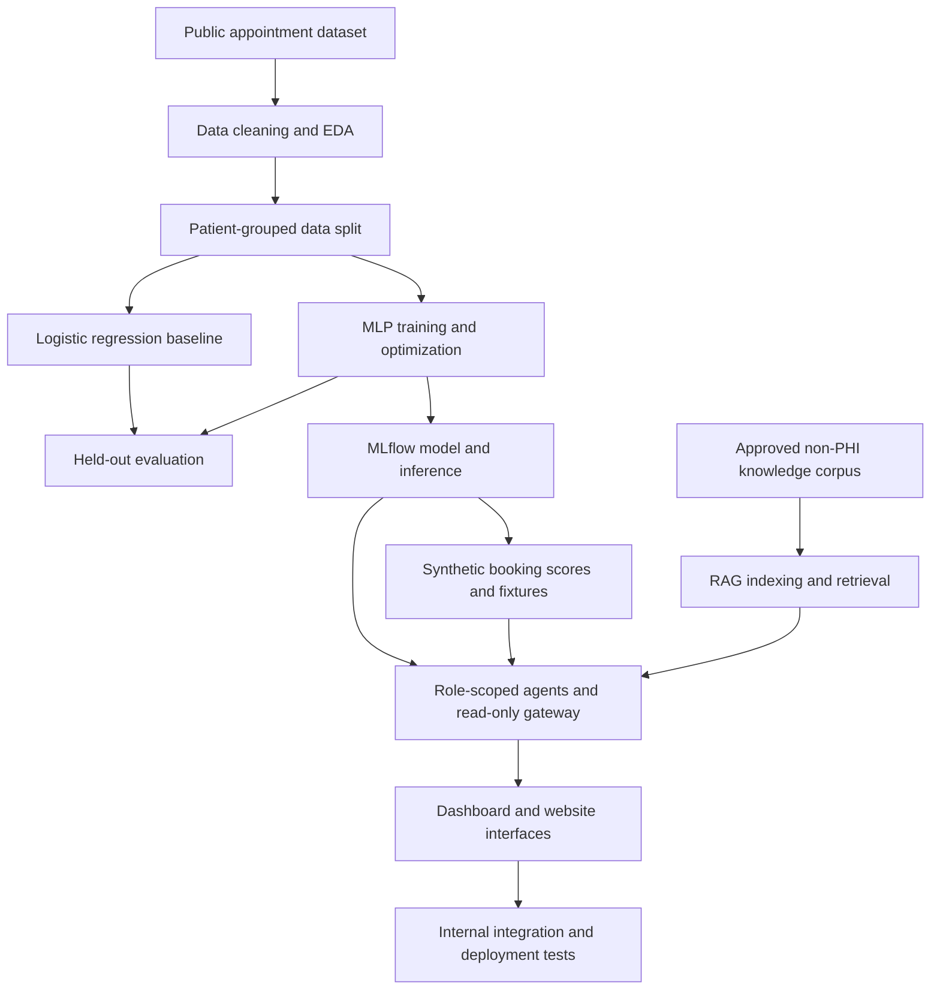

# Eye Style Optometry: AI Operations & Workflow Intelligence

**University of San Diego | Master of Science in Applied Artificial Intelligence | AAI590 Capstone | Team 2**


## Project Overview

Independent optometry practices manage scheduling, insurance verification, optical orders and patient follow-up across multiple operational workflows. This capstone develops an educational AI-powered decision-support prototype for Eye Style Optometry to help staff identify unresolved tasks, prioritize follow-up and retrieve relevant operational information.

The platform combines supervised machine learning, retrieval-augmented generation (RAG), role-scoped AI agents and dashboard-facing interfaces. It is designed to support staff decisions rather than autonomously change patient records or make clinical decisions.

**Project status:** Prototype evaluation completed in the original notebook; migration to a modular GitHub repository is underway. The separated pipeline requires end-to-end Databricks validation. Live Crystal PM integration, production authentication and HTTP deployment remain future work.

## Team Members

| Team member | GitHub | Responsibilities |
|---|---|---|
| Thomas Geraci | [@Tom123454321876](https://github.com/Tom123454321876) | AI architecture, agent orchestration, security, dashboard integration and system evaluation |
| Denis Mulabegovic | [@DMulabegovic](https://github.com/DMulabegovic) | Logistic regression, neural network development, hyperparameter optimization, evaluation and inference |
| Daniel Sims | [@dsims21](https://github.com/dsims21) | Data preparation, exploratory data analysis, synthetic records, RAG retrieval and grounding evaluation |

## Core Capabilities

- **Scheduling:** Booking-time no-show scoring and staff follow-up prioritization.
- **Insurance verification:** Identification of missing or unresolved verification information.
- **Optical orders:** Read-only order status, delays and follow-up reporting.
- **Knowledge assistant:** Retrieval of relevant operational guidance, source-grounded answers and abstention when evidence is insufficient.
- **Role-scoped agents:** Restricted tool access, routing and human approval requirements.
- **Dashboard integration:** Structured outputs and internal website-facing interfaces for operational review.

## System Architecture



See [architecture documentation](docs/architecture.md) for additional implementation details.

## Technology Stack

| Technology | Purpose |
|---|---|
| Python and Jupyter | Development, experimentation and reproducible notebook stages |
| Databricks | Shared development environment, compute and data storage |
| Pandas and NumPy | Data cleaning, transformation and analysis |
| Scikit-learn | Preprocessing, logistic regression and evaluation metrics |
| TensorFlow / Keras | Multilayer perceptron training and optimization |
| MLflow | Model logging, loading and verification |
| Sentence Transformers | Dense retrieval embeddings |
| Databricks model serving / OpenAI-compatible SDK | Language-model inference |
| Matplotlib and Seaborn | Exploratory and evaluation visualizations |
| GitHub | Version control, collaboration and documentation |

## Data and Machine Learning

The predictive component uses the public [Medical Appointment No Shows dataset](https://www.kaggle.com/datasets/joniarroba/noshowappointments). Six invalid records were excluded, leaving 110,521 appointments. The dataset is not from Eye Style Optometry and does not establish performance in a U.S. optometry practice.

| Partition | Appointments |
|---|---:|
| Training | 77,565 |
| Validation | 16,534 |
| Held-out test | 16,422 |

Patient-grouped splitting prevents patient overlap between partitions. Preprocessing is fitted on training records only. Booking-time features exclude patient identifiers and SMS status to reduce leakage risks. The operational prototype uses synthetic Crystal-style records and a separate non-PHI knowledge corpus.

The predictive pipeline compares a class-weighted logistic regression baseline with a regularized multilayer perceptron (MLP). Optimization includes hidden-layer widths, dropout, early stopping and validation-based threshold selection. The test set is reserved for final evaluation. The resulting no-show score is uncalibrated and intended for human-reviewed follow-up only.

## Evaluation Results

The following are historical results from the original Week 6 notebook, not newly reproduced results from the modular repository.

| Evaluation | Reported result |
|---|---:|
| MLP no-show recall | 77.05% |
| MLP no-show F1 | 43.68% |
| MLP ROC-AUC | 72.02% |
| RAG in-corpus grounded answers | 15/15 (100%) |
| RAG appropriate abstention | 5/5 (100%) |
| Workflow task correctness | 9/9 (100%) |
| Strict workflow correctness | 7/9 (77.8%) |
| Median AI workflow execution time | 6.418 seconds |
| Website interface checks | 14/14 passed |
| Internal deployment checks | 6/6 passed |

The selected RAG experiment used 95-word chunks, 25-word overlap and top-k = 3. Grounding was evaluated on a fixed question set using LLM judging; additional independent evaluation is necessary. No paired manual workflow timing baseline was collected, so a speed improvement over staff workflows has not been established. Model precision, subgroup disparities and false positives remain important deployment concerns.

See [evaluation results](docs/results.md) for limitations and model-run provenance.

## Repository Structure

The following is the target layout as team members merge their respective packages.

```text
USD-AAI590-Capstone/
├── .github/          # CODEOWNERS
├── agents/           # Agent framework, integration and security
├── config/           # Shared configuration and stage manifest
├── data_pipeline/    # Cleaning, EDA and synthetic records
├── docs/             # Architecture, results and execution instructions
├── evaluation/       # Workflow and integration testing
├── integration/      # Dashboard, gateway and deployment interfaces
├── machine_learning/ # Baseline, MLP, optimization and inference
├── rag/              # Corpus, retrieval and grounding
├── src/              # Reusable agent and data utilities
├── tests/            # Repository structure checks
├── tools/            # Private setup utilities
├── .gitignore
├── README.md
├── requirements.txt
├── run_pipeline.ipynb
└── run_stages.py
```

## Installation and Execution

1. Clone this repository into an authorized Databricks Git folder.
2. Install dependencies from `requirements.txt` in a compatible Databricks environment.
3. Obtain the public appointment dataset and configure authorized private storage and workspace access following [private setup](docs/private_setup.md).
4. Open `run_pipeline.ipynb` and execute the stages in the order specified in [execution order](docs/execution_order.md).
5. Review newly generated answers at the required manual review gates and compare new metrics with [historical results](docs/results.md).

The 25 functional notebooks are linked stages that share a Python namespace; they are not all independently executable. Dependency ranges are not a verified lockfile. The modular code has undergone static checks but requires runtime validation in Databricks before reproducibility can be claimed.

## Security, Privacy and Responsible AI

- Public appointment data and synthetic operational records are used for prototype evaluation; production patient data is not required.
- Role-scoped policies and read-only gateway checks restrict permitted operations. These are prototype controls, not proof of production authorization security.
- Appointment scores must never automatically cancel, overbook or modify appointments.
- Credentials, private datasets, vendor API specifications, saved predictions and model binaries must not be committed to the public repository.
- Any vendor contract required for development must be supplied privately with authorization. If authorization is unavailable, use an approved synthetic-only substitute and validate the gateway.
- Production identity verification, least-privilege authorization and human approval must be enforced at the deployed service boundary.

## Limitations and Future Work

The current prototype does not establish clinical performance, live Crystal PM connectivity or real-world workflow efficiency. Future work includes representative clinic-data validation, probability calibration, subgroup fairness analysis, additional retrieval evaluation, paired staff timing studies, production authentication, secure API deployment and monitoring. The modular pipeline also requires end-to-end reproduction testing.

## Collaboration and Documentation

Team members maintain their respective workstreams through feature branches, descriptive commits and reviewed pull requests into `main`.

Additional project documentation:

- [System Architecture](docs/architecture.md)
- [Data Dictionary](docs/data_dictionary.md)
- [Execution Order](docs/execution_order.md)
- [Evaluation Results](docs/results.md)
- [GitHub Contribution Instructions](docs/github_upload.md)
- [Migration Notes](docs/migration_notes.md)
- [Private Environment Setup](docs/private_setup.md)

## References

- Hoppen, J. (2016). *Medical Appointment No Shows* [Data set]. Kaggle. https://www.kaggle.com/datasets/joniarroba/noshowappointments
- Carreras-García, D., et al. (2020). Patient no-show prediction: A systematic literature review. *Entropy, 22*(6), 675. https://doi.org/10.3390/e22060675
- Lewis, P., et al. (2020). Retrieval-augmented generation for knowledge-intensive NLP tasks. *Advances in Neural Information Processing Systems, 33*, 9459–9474.
- Mohammadi, I., et al. (2018). Data analytics and modeling for appointment no-show in community health centers. *Journal of Primary Care & Community Health, 9*. https://doi.org/10.1177/2150132718811692
- Salazar, L. H. A., et al. (2022). No-show in medical appointments with machine learning techniques: A systematic literature review. *Information, 13*(11), 507. https://doi.org/10.3390/info13110507
- Zakka, C., et al. (2024). Almanac — Retrieval-augmented language models for clinical medicine. *NEJM AI, 1*(2). https://doi.org/10.1056/AIoa2300068

---

**University of San Diego — AAI590 Capstone, Team 2**

Educational research prototype; not a production clinical system.
