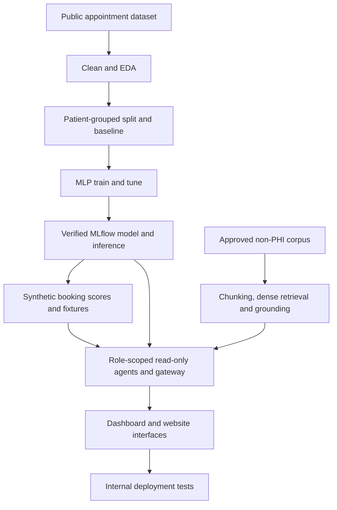

# Architecture

The original gateway performs authorization and read-only tool checks; it uses a privately supplied API contract in demo mode. The website interface trusts server-supplied roles; actual Firebase verification must be implemented at the external boundary. Do not deploy notebook functions as an unauthenticated service. The no-show score is not calibrated and is intended only for human-reviewed follow-up.
